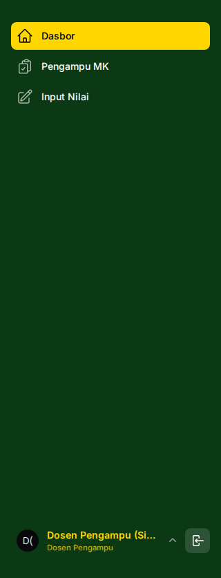
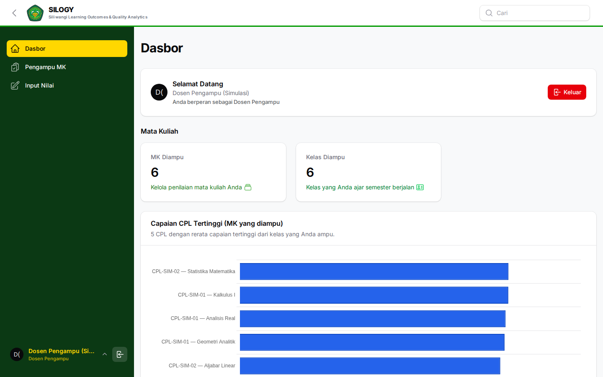
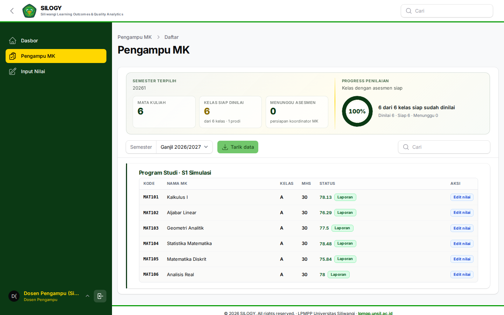
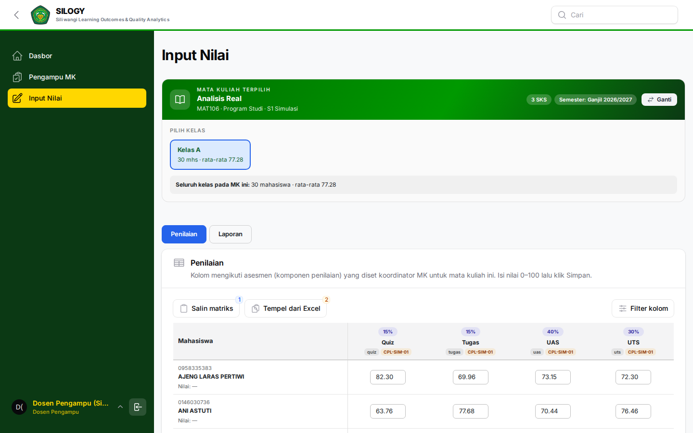

# Panduan Dosen Pengampu

Alamat SILOGY: **https://silogy.unsil.ac.id/login**

Dosen Pengampu menjalankan kelas dan **menginput nilai mahasiswa** sesuai komponen penilaian yang telah disiapkan Koordinator Mata Kuliah.

## Kewenangan utama

- Mengelola kelas yang diampu lewat **Input Nilai** (pilih kelas).
- **Input Nilai** mahasiswa.
- **Import Nilai** (unggah massal).
- Melihat laporan dan dashboard.

## Menu yang tersedia

- **Penilaian → Input Nilai**: halaman utama pengisian nilai dan laporan kelas yang diampu.
- Menu **Kelas MK** tidak ditampilkan untuk Dosen Pengampu (pengelolaan struktur kelas tetap di Admin Prodi / Koordinator).

## Alur kerja

### 1. Buka kelas yang diampu
1. Buka **Penilaian → Input Nilai**.
2. Pilih **kelas** (dan mata kuliah) yang diampu dari pemilih kelas.
3. Pastikan kelas, mata kuliah, dan semester sudah benar. Bila ada kekeliruan penugasan, hubungi Admin Prodi/Koordinator MK.

### 2. Input nilai
1. Pada halaman **Input Nilai**, pastikan kelas yang benar sudah terpilih.
2. Akan tampil daftar mahasiswa beserta **komponen penilaian** (mis. Tugas, UTS, UAS) yang telah ditetapkan Koordinator.
3. Isikan nilai tiap mahasiswa per komponen.
4. Klik **Simpan**. Nilai akan dihitung dan dipetakan ke ketercapaian CPMK/Sub-CPMK.

### 3. Import nilai (opsional, untuk jumlah besar)
1. Pada halaman penilaian, pilih **Import**.
2. Unduh **template** yang disediakan.
3. Isi nilai pada template (jangan mengubah kolom kunci seperti NIM/kode komponen).
4. Unggah kembali file tersebut, lalu konfirmasi. Periksa ringkasan hasil import dan perbaiki baris yang gagal bila ada.

## Merinci nilai per Sub-CPMK

Biasanya satu asesmen punya satu angka per mahasiswa, dan angka itu berlaku sama untuk semua Sub-CPMK yang dibebankan ke asesmen tersebut. Bila sebuah asesmen dibebankan ke **dua Sub-CPMK atau lebih**, di tab **Input** muncul tombol **Rinci per Sub-CPMK** pada kolomnya.

- Setelah dinyalakan, kolom asesmen terpecah menjadi satu kolom per Sub-CPMK. Isi angka tiap Sub-CPMK sendiri-sendiri; nilai asesmen menjadi rata-rata tertimbang bobot Sub-CPMK itu. Angka yang sudah ada tidak berubah saat tombol dinyalakan, sehingga nilai akhir mahasiswa tetap sama sampai Anda mengubahnya.
- **Gabungkan kembali** mengembalikan satu angka per asesmen. Angka terpisah per Sub-CPMK hilang (Anda diminta mengonfirmasi), dan nilai asesmen menjadi rata-ratanya.
- Tombol tidak bisa dipakai selama masih ada perubahan yang belum disimpan; simpan dulu.
- Saat menempel dari Excel, pakai judul kolom seperti `UTS/SUB-1A`. Selama ada asesmen yang dirinci, baris judul kolom wajib ikut ditempel; data tanpa baris judul ditolak supaya angka tidak masuk ke kolom yang salah.
- Pada **Laporan Lengkap**, bagian **C3. Ketercapaian Sub-CPMK** menandai tiap Sub-CPMK **Tercapai** atau **Lemah**. Kolom Dasar berisi **Terukur terpisah** bila angkanya diisi sendiri, atau **Tidak dapat dibedakan** bila Sub-CPMK itu hanya diukur lewat asesmen bersama yang tidak dirinci, sehingga angkanya sama dengan Sub-CPMK lain dan tidak bisa dibandingkan. **Terlemah** menandai Sub-CPMK dengan ketercapaian paling rendah, tetapi yang dibandingkan hanya Sub-CPMK bertanda **Terukur terpisah**, dan tanda ini baru muncul bila ada sedikitnya dua Sub-CPMK seperti itu.
- Menyalakan **Rinci per Sub-CPMK** atau menekan **Gabungkan kembali** membuat kelas harus divalidasi ulang, walaupun angkanya tidak berubah. Bila kelas sudah tervalidasi, Anda diminta mengonfirmasi lebih dulu.
- Mengubah skor per Sub-CPMK juga menggugurkan validasi, seperti perubahan nilai lainnya; kelas lalu perlu divalidasi ulang.

## Mencetak laporan memerlukan validasi

Tombol **Cetak** pada tab **Laporan Lengkap** hanya aktif bila kelas sudah **Tervalidasi** oleh Validator Nilai. Cetakan dari kelas yang belum divalidasi (termasuk lewat Ctrl+P) bertanda air **BELUM DIVALIDASI**.

- Validasi **gugur** bila nilai, bobot, pemetaan, peserta, atau isi Analisis & RTL berubah. Menekan **Simpan** tanpa mengubah nilai tidak menggugurkannya.
- Nilai tidak dikunci; Anda tetap bisa mengubahnya, tetapi kelas lalu perlu divalidasi ulang.
- Aturan ini berlaku untuk semua kelas, juga semester lampau.
- Hubungi Validator Nilai di unit Anda untuk meminta validasi. Lihat [Panduan Validator Nilai](09-validator-nilai.md).

## Praktik baik

- Pastikan komponen penilaian sudah tersedia sebelum input. Jika belum, hubungi Koordinator MK.
- Simpan berkala saat menginput banyak data.
- Saat import, gunakan template terbaru dan jangan mengubah header kolom.
- Periksa kembali nilai sebelum periode penilaian ditutup.
- Gunakan tab laporan di Input Nilai / dashboard untuk melihat ketercapaian pembelajaran kelas Anda.

## Catatan

Struktur komponen penilaian dan bobotnya ditetapkan oleh **Koordinator Mata Kuliah**. Dosen mengisi nilai pada struktur tersebut.
