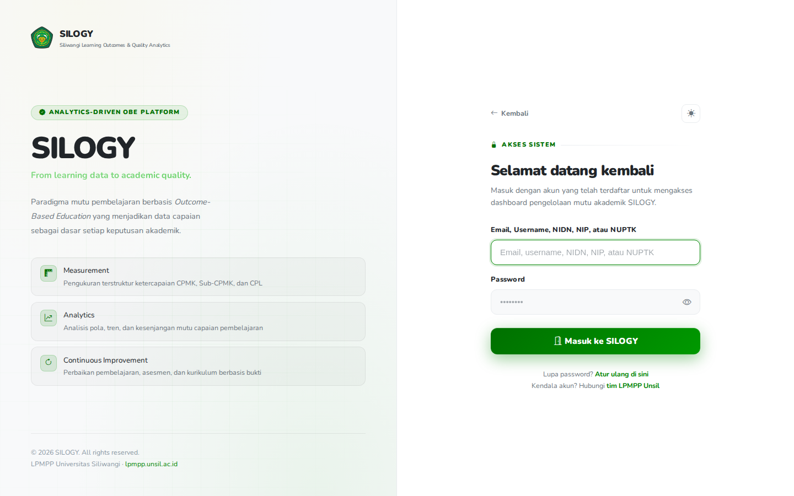

# Panduan Validator Nilai

Alamat SILOGY: **https://silogy.unsil.ac.id/login**

Validator Nilai memeriksa nilai per kelas dan **memvalidasi**-nya. Laporan Lengkap sebuah kelas baru bisa dicetak setelah kelas itu divalidasi, sehingga cetakan menjadi bukti bahwa hasil penilaian dosen pengampu sudah diperiksa pihak penjamin mutu (misalnya UPM).

## Masuk

1. Buka alamat di atas, masukkan **Username** dan **Password** Anda, lalu klik **Masuk ke SILOGY**.
2. Bila akun Anda punya lebih dari satu peran, pilih peran **Validator Nilai**.

## Kewenangan utama

- Melihat daftar kelas dalam cakupan Anda, per semester, termasuk semester lampau.
- Membuka laporan kelas dalam tampilan **hanya baca**.
- **Memvalidasi** kelas, dan **membatalkan validasi**.
- Mencetak Laporan Lengkap kelas yang sudah tervalidasi.

Anda tidak mengubah nilai, bobot, maupun peserta. Bila ada yang janggal, cukup jangan validasi, lalu sampaikan ke dosen pengampu atau Koordinator MK di luar sistem.

## Siapa yang menjadi validator

Peran ini mengikuti **penanda pada penugasan unit**, bukan dipasang terpisah.

1. Super Admin membuka data pengguna, atau Admin unit membuka data unit, pada bagian penugasan unit.
2. Pada penugasan unit yang dimaksud, nyalakan sakelar **Validator nilai**, lalu simpan.
3. Peran **Validator Nilai** terpasang otomatis pada pengguna itu. Bila semua penanda dimatikan, peran ikut lepas.

Penanda berlaku per penugasan. Dosen di prodi A yang juga ditugaskan sebagai validator di prodi B hanya menjadi validator di prodi B.

## Cakupan

Cakupan Anda adalah unit yang berpenanda **Validator nilai** **beserta semua unit di bawahnya**.

- Validator di prodi memvalidasi semua kelas yang **ditawarkan prodi itu**, termasuk kelas dari mata kuliah milik fakultas atau universitas.
- Validator yang ditugaskan di fakultas atau universitas juga mencakup semua program studi di bawahnya.
- Kelas di luar cakupan tidak tampil dan tidak bisa dibuka.

## Menu yang tersedia

- **Penilaian → Validasi Nilai**.

Menu ini hanya muncul untuk peran Validator Nilai.

## Tugas yang sering dilakukan

### 1. Memilih semester dan kelas
1. Buka **Penilaian → Validasi Nilai**.
2. Pilih **Semester**. Semester lampau juga tersedia.
3. Daftar menampilkan mata kuliah, kelas, dosen, jumlah nilai terisi (misalnya `31/40`), dan status validasi.

Daftar hanya punya tombol **Lihat**. Tombol Validasi tidak ada di daftar, supaya kelas tidak bisa divalidasi tanpa membuka laporannya.

### 2. Memeriksa dan memvalidasi
1. Tekan **Lihat** pada kelas yang akan diperiksa.
2. Telaah laporan kelas pada tab-tabnya: nilai mahasiswa, ketercapaian CPL, distribusi nilai, rencana evaluasi, dan Analisis & RTL.
3. Bila sudah yakin, tekan **Validasi** lalu konfirmasi.
4. Status kelas berubah menjadi **Tervalidasi**.

**Validasi** hanya bisa ditekan bila:
- nilai kelas sudah **lengkap** (tidak ada sel kosong), dan
- penugasan asesmen sudah selesai (bobot komponen berjumlah 100% dan seluruhnya terpetakan ke Sub-CPMK).

Bila syarat belum terpenuhi, tombol **Validasi** tidak muncul; alasannya tampil sebagai catatan pada halaman laporan kelas.

Anda **tidak dapat** memvalidasi kelas yang Anda ampu, maupun kelas dari mata kuliah yang Anda koordinatori, karena koordinator yang menentukan bobot dan pemetaan yang menjadi dasar laporan. Super Admin pun tidak otomatis boleh memvalidasi.

Jika data berubah setelah laporan Anda buka (misalnya dosen menyimpan nilai saat Anda memeriksa), validasi ditolak dengan pesan agar Anda memeriksa kembali. Laporan dimuat ulang; periksa lalu validasi lagi.

### 3. Membatalkan validasi
1. Buka kelas lewat **Lihat**.
2. Tekan **Batalkan validasi** lalu konfirmasi.
3. Status kembali menjadi **Belum divalidasi** dan laporan tidak bisa dicetak sampai divalidasi lagi.

### 4. Mencetak
Pada kelas yang **Tervalidasi**, tombol **Cetak** di tab Laporan Lengkap aktif. Cetakan memuat blok **Divalidasi oleh** berisi nama Anda, jabatan penugasan (bila ada), serta tanggal dan jam validasi.

## Arti status validasi

| Status | Arti | Cetak |
|---|---|---|
| **Belum divalidasi** | Kelas belum pernah divalidasi, atau validasinya dibatalkan. | Tombol terkunci. Cetakan apa pun bertanda air **BELUM DIVALIDASI**. |
| **Tervalidasi** | Isi laporan sama persis dengan yang Anda validasi. | Tombol aktif. Cetakan memuat blok **Divalidasi oleh**. |
| **Perlu validasi ulang** | Pernah divalidasi, tetapi isi laporan berubah sesudahnya. | Tombol terkunci. Cetakan bertanda air **BELUM DIVALIDASI**. |

## Kapan validasi gugur

Validasi gugur otomatis, menjadi **Perlu validasi ulang**, bila isi laporan berubah, yaitu:

- nilai mahasiswa diubah, diimpor, atau dihapus;
- bobot komponen penilaian berubah;
- pemetaan komponen ke Sub-CPMK/CPMK/CPL berubah;
- peserta kelas bertambah atau berkurang;
- isi **Analisis & RTL** (analisis, rencana tindak lanjut, catatan umum) berubah;
- penugasan asesmen tidak lagi selesai;
- identitas kelas berubah: dosen pengampu, nama/kode MK, SKS, atau semester.

Menekan **Simpan** di Input Nilai tanpa mengubah satu nilai pun **tidak** menggugurkan validasi. Nilai tidak dikunci setelah validasi; dosen tetap bisa mengubahnya, hanya saja kelas itu lalu perlu divalidasi ulang. Selama ada nilai yang sudah diketik atau ditempel di Input Nilai tetapi belum disimpan, tombol **Cetak** terkunci dan cetakan bertanda air **BELUM DIVALIDASI**; simpan perubahannya, lalu minta validasi ulang.

Catatan tentang daftar: perubahan nilai langsung tampak di daftar. Perubahan lain (bobot, pemetaan, peserta, Analisis & RTL, identitas kelas) baru terdeteksi saat laporan kelas itu dibuka, sehingga daftar bisa masih menampilkan **Tervalidasi** sampai Anda membukanya. Cetakan tetap aman, sebab mencetak selalu lewat laporan yang sudah diperiksa terhadap data terkini.

## Berlaku untuk semua kelas

Aturan cetak ini berlaku untuk **semua kelas di semua semester**, termasuk kelas lama. Kelas lama berstatus **Belum divalidasi** sampai Anda memvalidasinya.

## Praktik baik
- Buka dan telaah laporan sebelum menekan Validasi; jangan memvalidasi dari daftar saja.
- Validasi setelah dosen dan Koordinator MK selesai mengubah data kelas, supaya tidak gugur berulang.
- Setelah dosen memperbaiki nilai atas permintaan Anda, buka kembali laporannya dan validasi ulang.
- Komunikasi perbaikan dilakukan di luar sistem; SILOGY tidak punya alur tolak dengan catatan.

## Catatan umum

Peran ini tidak menginput data kurikulum maupun nilai. Bila menemukan kekeliruan, koordinasikan dengan Dosen Pengampu atau Koordinator MK kelas terkait.
